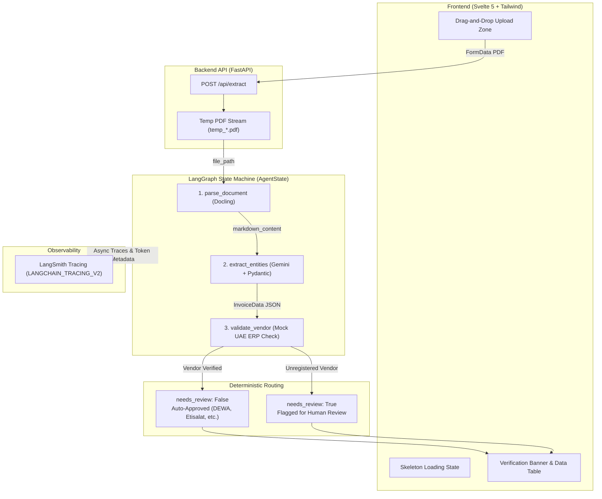
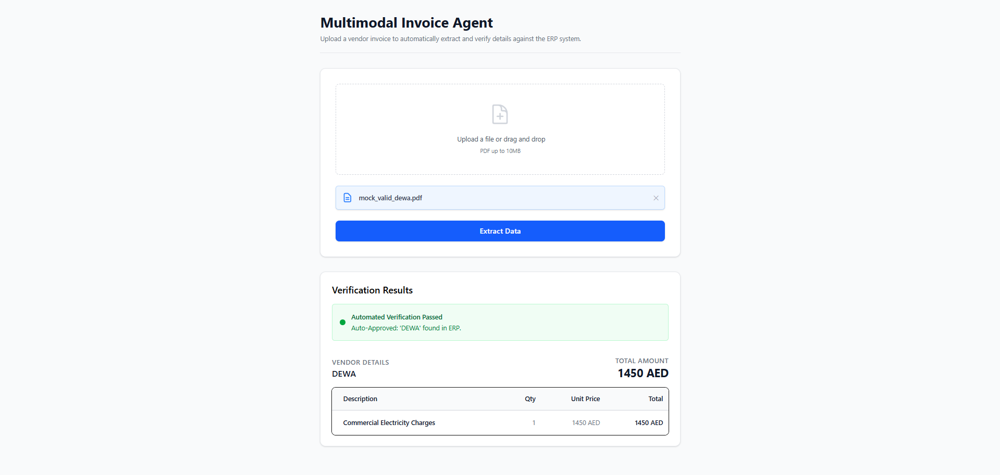
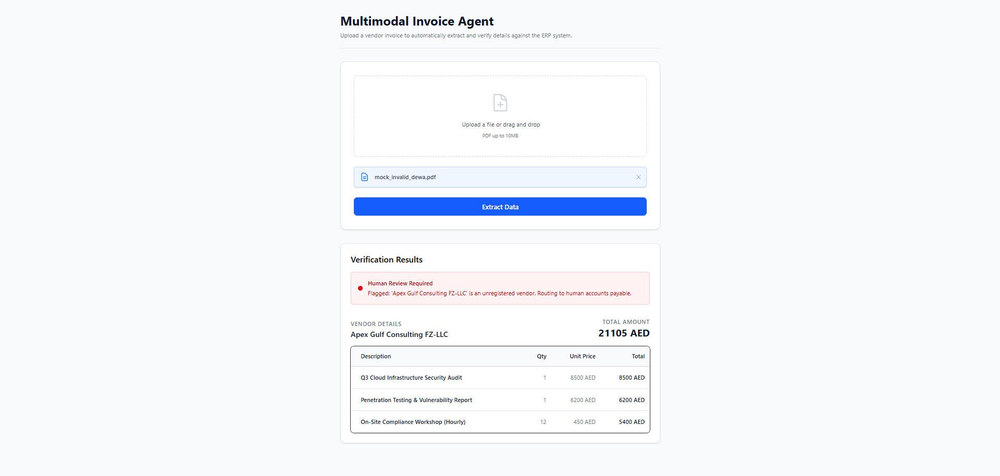
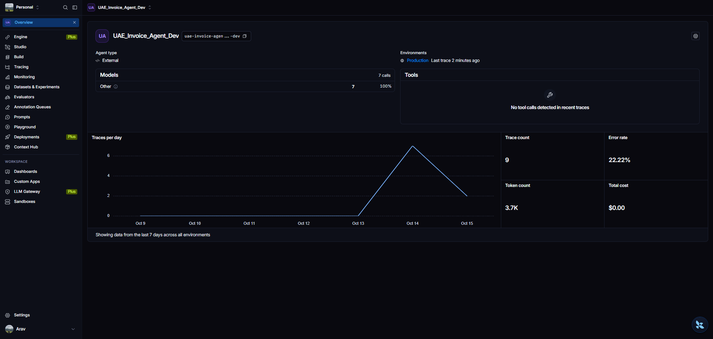

# Multimodal Invoice Processing & ERP Verification Agent

An enterprise-grade, stateful AI pipeline built with **LangGraph**, **FastAPI**, **Docling**, and **Svelte 5**. This system extracts structured line-item data from unstructured vendor PDF invoices and enforces deterministic ERP validation rules before routing documents for automated payment or human review.

---

## System Architecture



---

## Key Engineering Highlights

* **Stateful Agentic Workflow (LangGraph):** Replaces fragile prompt chains with a typed state graph (`AgentState`) that tracks document parsing, entity extraction, and verification flags across discrete execution nodes.
* **Deterministic Hallucination Guardrails:** Never trusts raw LLM outputs blindly. Extracted vendor entities are cross-referenced against a mock UAE corporate ERP registry (`DEWA`, `Emirates Post`, `Etisalat`, `Careem Logistics`) using strict programmatic rules. Unregistered vendors are automatically flagged for manual intervention.
* **Layout-Aware Document Parsing (Docling):** Converts complex multi-column PDF layouts and tabular structures into clean Markdown representations prior to LLM inference, maximizing extraction accuracy.
* **Fail-Safe Frontend Architecture (Svelte 5 + Tailwind CSS):** Built with Svelte 5 Runes (`$state`, `$derived`), full-box accessible drag-and-drop zones, skeleton loading animations, and defensive null-coalescing fail-safes (`needs_review ?? true`) so malformed payloads never fail open.
* **Production Observability (LangSmith):** Full telemetry integration using `@traceable` decorators and custom `RunTree` usage metadata injection (`get_current_run_tree()`) to monitor node latency, token consumption, and state transitions in real time.

---

## Tech Stack

| Layer | Technology | Purpose |
| :--- | :--- | :--- |
| **Frontend** | Svelte 5 (Runes), Tailwind CSS, Vite | Reactive UI, drag-and-drop file upload, dynamic status banners & data tables |
| **Backend API** | FastAPI, Uvicorn, Python 3.12 | Asynchronous REST API, multipart stream handling, and automatic file cleanup |
| **Document Parsing** | Docling | Layout-aware PDF parsing and Markdown serialization |
| **Orchestration & LLM** | LangGraph, Google Gemini, Pydantic | Structured schema extraction (`InvoiceData`) and conditional state routing |
| **Observability** | LangSmith | Distributed tracing, token usage tracking, error rate & latency monitoring |
| **Package Management** | `uv`, `pnpm` | Deterministic dependency locking across environments |

---

## Visual Walkthrough


| Auto-Approved Invoice (`DEWA`) | Flagged Unregistered Vendor | LangSmith Telemetry Trace |
| :---: | :---: | :---: |
|  |  |  |

---

## Local Setup & Installation

### Prerequisites
* **Python 3.12+** and [`uv`](https://docs.astral.sh/uv/)
* **Node.js 20+** and [`pnpm`](https://pnpm.io/)
* A **Google Gemini API Key** and **LangSmith API Key**

### 1. Clone the Repository
```bash
git clone https://github.com/TherealArav/agentic_policy_invoice.git
cd agentic_policy_invoice
```

### 2. Backend Setup
Navigate to the `backend` directory, configure your environment variables, and launch the FastAPI server:

```bash
cd backend

# Create your .env file from the template
cp .env.example .env
```

Open `backend/.env` and populate your credentials:
```env
GOOGLE_API_KEY="your-gemini-api-key-here"
LANGCHAIN_TRACING_V2="true"
LANGCHAIN_API_KEY="your-langsmith-api-key-here"
LANGCHAIN_PROJECT="UAE_Invoice_Agent_Dev"
```

Install the locked Python dependencies and start Uvicorn:
```bash
uv sync
uv run uvicorn server:app --host 0.0.0.0 --port 8000 --reload
```
*The API and interactive Swagger documentation will be available at `http://localhost:8000/docs`.*

### 3. Frontend Setup
Open a second terminal window, navigate to the `frontend` directory, and start the SvelteKit development server:

```bash
cd frontend

# Install dependencies
pnpm install

# Start the Vite dev server
pnpm run dev
```
*Navigate to `http://localhost:5173` in your browser to upload test PDF invoices.*

---

## Project Structure

```text
├── backend/
│   ├── main.py              # LangGraph state machine, Docling parser, Gemini extraction & ERP validation
│   ├── server.py            # FastAPI application, CORS config, and /api/extract endpoint
│   ├── pyproject.toml       # Python dependencies managed by uv
│   ├── uv.lock              # Deterministic Python lockfile
│   └── .env.example         # Environment variable template
├── frontend/
│   ├── src/
│   │   └── routes/
│   │       └── +page.svelte # Svelte 5 UI with Runes, dropzone, skeleton loader & data table
│   ├── package.json         # Frontend dependencies managed by pnpm
│   └── vite.config.ts       # Vite configuration
└── README.md                # System documentation and architecture overview
```

---

## Security & Reliability Design
* **Zero-Trust Validation:** Even if the LLM extracts a valid-looking invoice schema, the system defaults to `needs_review = True` unless the vendor explicitly matches the deterministic allowlist.
* **Ephemeral File Handling:** Uploaded PDFs are processed via temporary file streams and guaranteed to be unlinked from the server filesystem inside a `finally` block immediately after graph execution.
* **Strict Schema Enforcement:** Pydantic models enforce strict typing on line-item quantities, unit prices, and totals before the payload ever reaches the validation node or client UI.