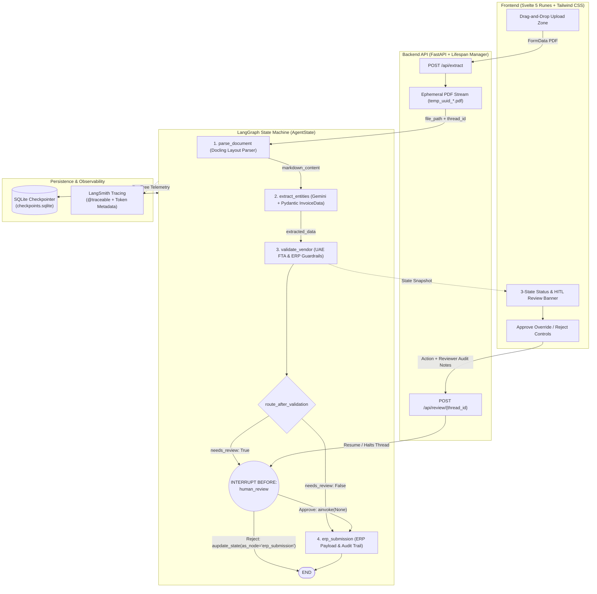
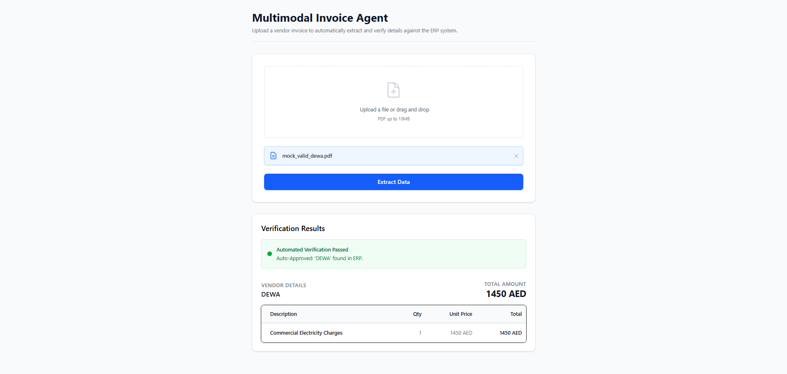
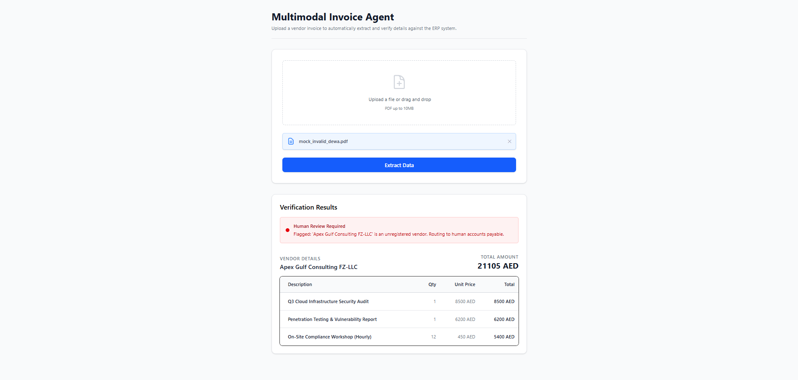
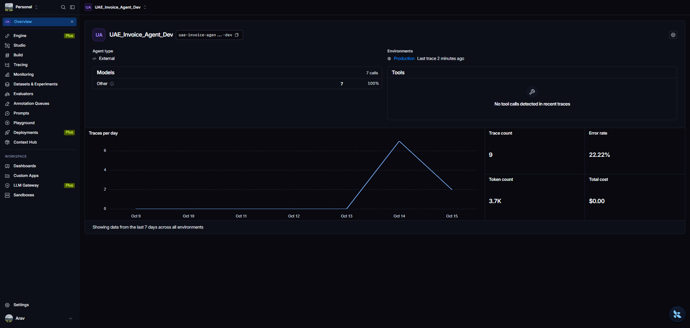

# Multimodal Invoice Processing & UAE FTA Compliance Agent


An enterprise-grade, stateful AI pipeline built with **LangGraph**, **FastAPI**, **Docling**, **Google Gemini**, and **Svelte 5**. This system extracts structured financial and line-item data from unstructured vendor PDF invoices, enforces deterministic **UAE Federal Tax Authority (FTA)** and **ERP** compliance guardrails, and uses persistent **Human-in-the-Loop (HITL)** state checkpointing (`AsyncSqliteSaver`) to pause non-compliant invoices for asynchronous Accounts Payable (AP) review.

---

## System Architecture



---

## Deterministic UAE FTA & ERP Compliance Guardrails

LLMs excel at unstructured layout extraction but are prone to arithmetic hallucinations. This system enforces a strict **Separation of Concerns**: Google Gemini extracts structured entities into `schemas.py`, while pure Python in `validators.py` enforces four deterministic accounting and regulatory checks before any invoice reaches the ERP:

| Guardrail Rule | Validation Logic | Business & Regulatory Justification |
| :--- | :--- | :--- |
| **1. ERP Vendor Allowlist** | Case-insensitive match against approved vendor master list (`DEWA`, `Etisalat`, `Emirates Post`, `Careem Logistics`) | Prevents unauthorized or fraudulent vendor invoices from entering the Accounts Payable ledger. |
| **2. UAE TRN Format Check** | Strict regular expression `^100\d{12}$` against `vendor_trn` | Enforces UAE Federal Tax Authority (FTA) Tax Registration Number format (15 digits starting with prefix `100`) required for corporate VAT reclamation. |
| **3. Line-Item Math Audit** | $\left\|\text{subtotal} - \sum(\text{quantity} \times \text{unit\_price})\right\| \le 0.05$ | Programmatically recalculates line-item totals to catch LLM OCR misreads, smudged digits, or vendor billing errors. |
| **4. UAE 5% VAT Tolerance** | $\left\|\text{tax\_amount} - (\text{subtotal} \times 0.05)\right\| \le 0.05$ | Enforces the standard 5% UAE Value Added Tax rate within a strict `0.05 AED` rounding tolerance. |

*Note: All failed rules accumulate into a pipe-delimited diagnostic string (e.g., `Flagged: Unregistered vendor 'Apex' | Invalid TRN format '99988877' | Math mismatch... | VAT mismatch...`) so human reviewers have complete context.*

---

## Key Engineering Highlights

- **Asynchronous HITL State Persistence (`AsyncSqliteSaver`):** Compiled with `interrupt_before=["human_review"]` and bound to FastAPI's `lifespan` context manager. Flagged invoices freeze execution, release the HTTP connection, and persist their state to `checkpoints.sqlite` under a unique `UUIDv4` `thread_id`—surviving container restarts until an AP clerk approves or rejects the thread.
- **Modular Separation of Concerns (SoC):** Cleanly decoupled into `schemas.py` (Pydantic data contracts), `validators.py` (pure deterministic business logic), `main.py` (LangGraph node & edge orchestration), and `server.py` (FastAPI REST & lifespan layer).
- **Automated CI/CD Testing Pipeline:** Unit tests in `backend/tests/test_validation.py` verify compliant invoices, invalid TRN prefixes, line-item math mismatches, and VAT calculation errors automatically on every push via GitHub Actions (`ci.yml`) without consuming LLM tokens.
- **Layout-Aware Document Parsing (Docling):** Converts complex multi-column PDF layouts and tabular structures into structured Markdown prior to LLM inference.
- **Reactive 3-State Frontend (Svelte 5 Runes):** Built with Svelte 5 Runes (`$state`, `$derived`), full-box accessible drag-and-drop zones, UAE tax breakdown cards, and an interactive AP Reviewer toolbar that transitions seamlessly between **Paused (Amber)**, **Approved (Green)**, and **Rejected (Red)** states.
- **Production Observability (LangSmith):** Full telemetry integration using `@traceable` decorators and custom `RunTree` usage metadata injection (`get_current_run_tree()`) to monitor node latency, prompt/candidate token consumption, and state transitions in real time.

---

## Tech Stack

| Layer | Technology | Purpose |
| :--- | :--- | :--- |
| **Frontend** | Svelte 5 (Runes), Tailwind CSS, Vite | Reactive UI, drag-and-drop file upload, 3-state HITL review banner & UAE tax summary cards |
| **Backend API** | FastAPI, Uvicorn, Python 3.12 | Asynchronous REST API, lifespan connection pooling, multipart stream handling & cleanup |
| **State & Persistence** | LangGraph, `langgraph-checkpoint-sqlite`, `aiosqlite` | Stateful agent orchestration, `interrupt_before` breakpoints, and persistent SQLite checkpointing |
| **Document Parsing** | Docling | Layout-aware PDF table parsing and Markdown serialization |
| **LLM & Contracts** | Google GenAI SDK (`gemini-3.6-flash`), Pydantic | Zero-temperature structured schema extraction (`InvoiceData` & `LineItem`) |
| **Testing & CI/CD** | `pytest`, GitHub Actions | Automated unit testing of deterministic UAE tax and math guardrails |
| **Observability** | LangSmith | Distributed tracing, token usage tracking, error rate & latency monitoring |
| **Packaging & Ops** | Docker Compose, `uv`, `pnpm` | Multi-container orchestration and deterministic lockfiles |

---

## Visual Walkthrough

| Auto-Approved Invoice (`DEWA`) | Paused for Human Review (HITL) | LangSmith Telemetry Trace |
| :---: | :---: | :---: |
|  |  |  |

---

## API Reference

| Method | Endpoint | Description |
| :--- | :--- | :--- |
| `POST` | `/api/extract` | Accepts a `multipart/form-data` PDF file, initializes a `UUIDv4` `thread_id`, executes the LangGraph pipeline, and returns the extracted data alongside `"status": "completed"` or `"status": "paused_for_review"`. |
| `POST` | `/api/review/{thread_id}` | Accepts `{"action": "approve" \| "reject", "reviewer_notes": "..."}`. Resumes paused threads into `erp_submission` via `ainvoke(None)` on approval, or halts execution cleanly via `aupdate_state(..., as_node="erp_submission")` on rejection. |

---

## Local Setup & Installation

### Prerequisites
- **Python 3.12+** and [`uv`](https://docs.astral.sh/uv/)
- **Node.js 20+** and [`pnpm`](https://pnpm.io/) (or `npm`)
- A **Google Gemini API Key** and **LangSmith API Key**
- **Docker** and **Docker Compose** (Recommended for containerized execution)

### 1. Clone the Repository
```bash
git clone https://github.com/TherealArav/agentic_policy_invoice.git
cd agentic_policy_invoice
```

### 2. Environment Configuration
Navigate to the `backend` directory and configure your environment variables:

```bash
cd backend
cp .env.example .env
```

Open `backend/.env` and populate your credentials:
```env
GOOGLE_API_KEY="your-gemini-api-key-here"
LANGCHAIN_TRACING_V2="true"
LANGCHAIN_API_KEY="your-langsmith-api-key-here"
LANGCHAIN_PROJECT="UAE_Invoice_Agent_Dev"
```

### 3. Run with Docker Compose (Recommended)
Launch the entire stack (FastAPI backend + SvelteKit frontend + persistent SQLite volume) with a single command from the project root:

```bash
# Return to the root directory
cd ..

# Build and start the containers in detached mode
docker compose up --build -d
```
- **Frontend UI:** `http://localhost:5173`
- **Backend Swagger Docs:** `http://localhost:8000/docs`

Useful Docker commands:
```bash
# View live container logs
docker compose logs -f

# Stop containers (SQLite checkpoints remain persisted on disk)
docker compose down
```

### 4. Run Locally (Without Docker)

#### Backend Setup
From the `backend` directory, install the locked Python dependencies and start Uvicorn:
```bash
cd backend
uv sync
uv run uvicorn server:app --host 0.0.0.0 --port 8000 --reload
```

#### Frontend Setup
Open a second terminal window, navigate to the `frontend` directory, and start the SvelteKit development server:
```bash
cd frontend
pnpm install
pnpm run dev
```

---

## Running the Automated Test Suite

The deterministic validation logic in `validators.py` is covered by `pytest` unit tests. Run the test suite locally from the `backend` directory:

```bash
cd backend
PYTHONPATH=. uv run pytest -v
```

---

## Project Structure

```text
├── .github/
│   └── workflows/
│       └── ci.yml                 # GitHub Actions CI pipeline running pytest via uv
├── backend/
│   ├── schemas.py                 # Pydantic data contracts (InvoiceData, LineItem)
│   ├── validators.py              # Deterministic UAE FTA (TRN, 5% VAT, Math) & ERP rules
│   ├── main.py                    # LangGraph state machine, Docling parser & Gemini node
│   ├── server.py                  # FastAPI lifespan, AsyncSqliteSaver, /extract & /review endpoints
│   ├── tests/
│   │   └── test_validation.py     # Unit tests for all deterministic validation guardrails
│   ├── pyproject.toml             # Python dependencies managed by uv
│   ├── uv.lock                    # Deterministic Python lockfile
│   ├── Dockerfile                 # Backend container definition
│   ├── .dockerignore              # Excludes host .venv and cache from container context
│   └── .env.example               # Environment variable template
├── frontend/
│   ├── src/
│   │   └── routes/
│   │       └── +page.svelte       # Svelte 5 UI with Runes, dropzone, 3-state HITL banner & tax cards
│   ├── package.json               # Frontend dependencies
│   ├── vite.config.ts             # Vite configuration & /api proxy
│   ├── Dockerfile                 # Frontend container definition
│   └── .dockerignore              # Excludes host node_modules from container context
├── docker-compose.yml             # Multi-container orchestration & volume mounts
└── README.md                      # System documentation and architecture overview
```

---

## Security & Reliability Design
- **Strict Deserialization Hardening (`CVE-2026-28277` Mitigation):** Enforces `os.environ["LANGGRAPH_STRICT_MSGPACK"] = "true"` prior to initializing `AsyncSqliteSaver`, locking down msgpack checkpoint deserialization to known-safe types and preventing arbitrary code execution.
- **Zero-Trust Validation:** Even if the LLM extracts a valid-looking invoice schema, the system defaults to `needs_review = True` unless the vendor, 15-digit UAE TRN, line-item subtotal math, and 5% VAT calculations all pass strictly in Python.
- **Idempotent HITL State Transitions:** The `/api/review/{thread_id}` endpoint inspects `snapshot.next` before applying state updates, preventing duplicate approvals or race-condition submissions.
- **Race-Condition-Free Ephemeral Files:** Uploaded PDFs are prefixed with `temp_{thread_id}_` to prevent concurrent filename collisions and are unlinked inside a `finally` block immediately after graph execution.